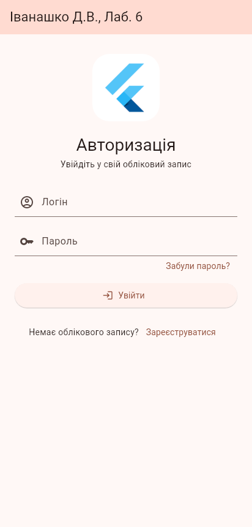
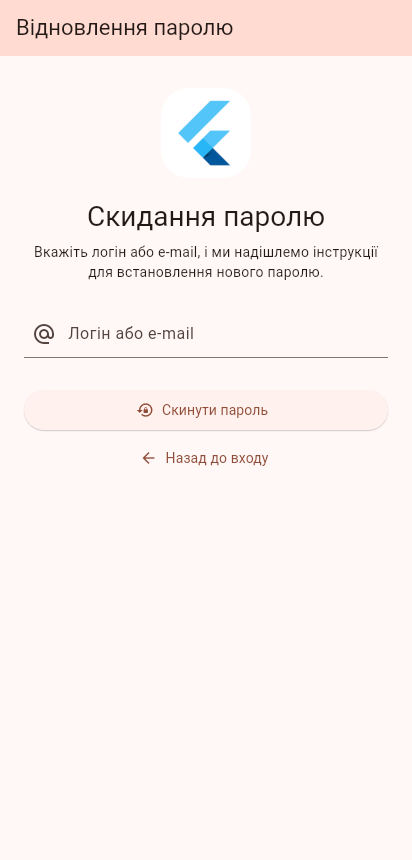

# Лабораторна робота №6 — Базові віджети для побудови інтерфейсу користувача

Виконав: Іванашко Д.В.

Екрани авторизації, реєстрації та відновлення паролю, побудовані з базових віджетів
`Image`, `TextField`, `ElevatedButton`, `OutlinedButton`, `TextButton`.

## Структура проєкту

```
lib/
├── main.dart
└── widgets/
    ├── sign_in_screen.dart
    ├── signup_screen.dart
    └── reset_password_screen.dart
```

## Скріншоти

| Авторизація | Реєстрація | Відновлення паролю |
|---|---|---|
|  |  |  |
